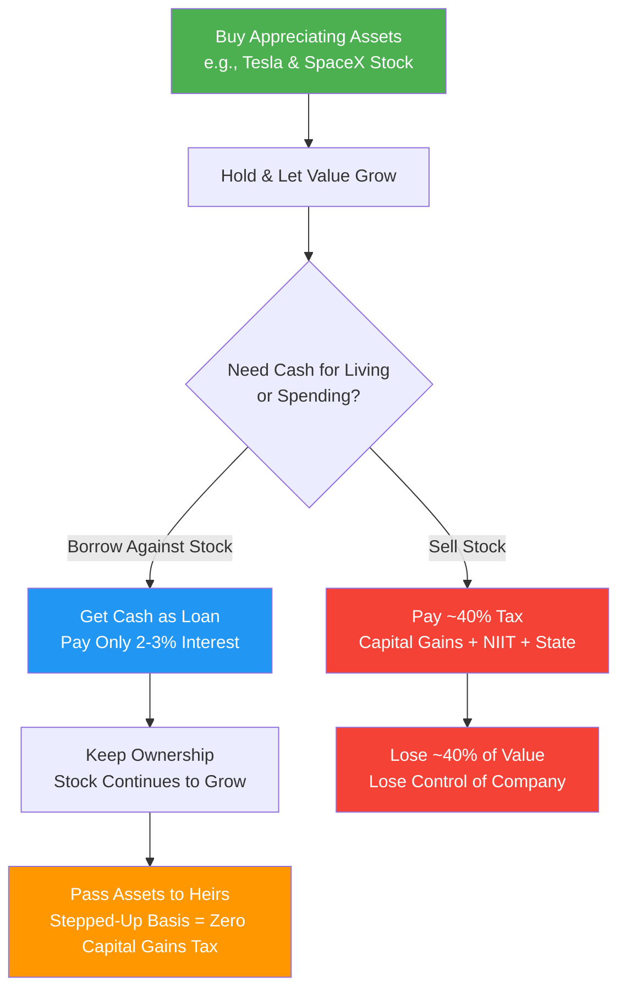
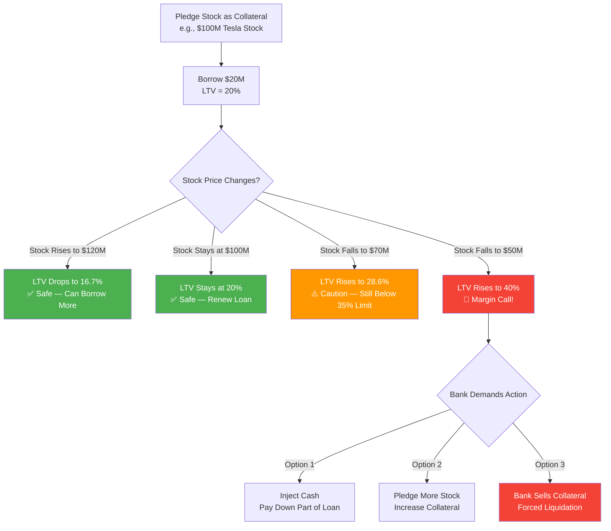
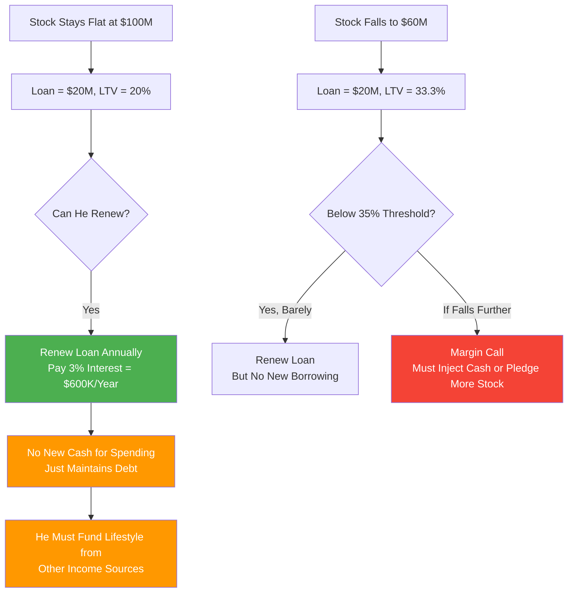
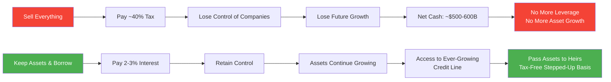
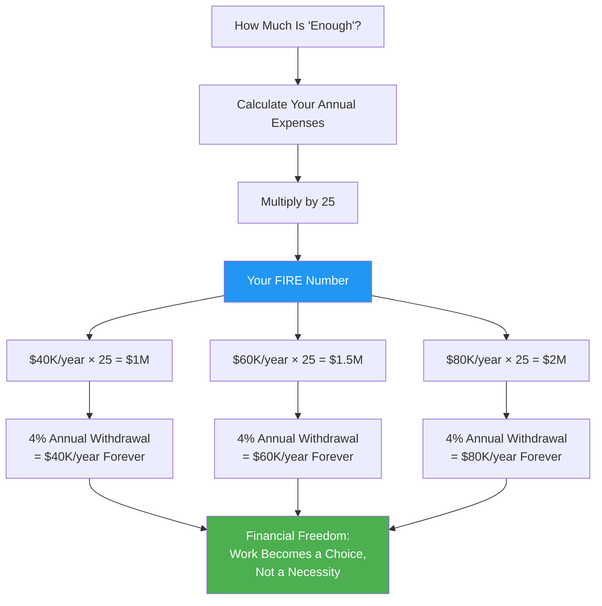
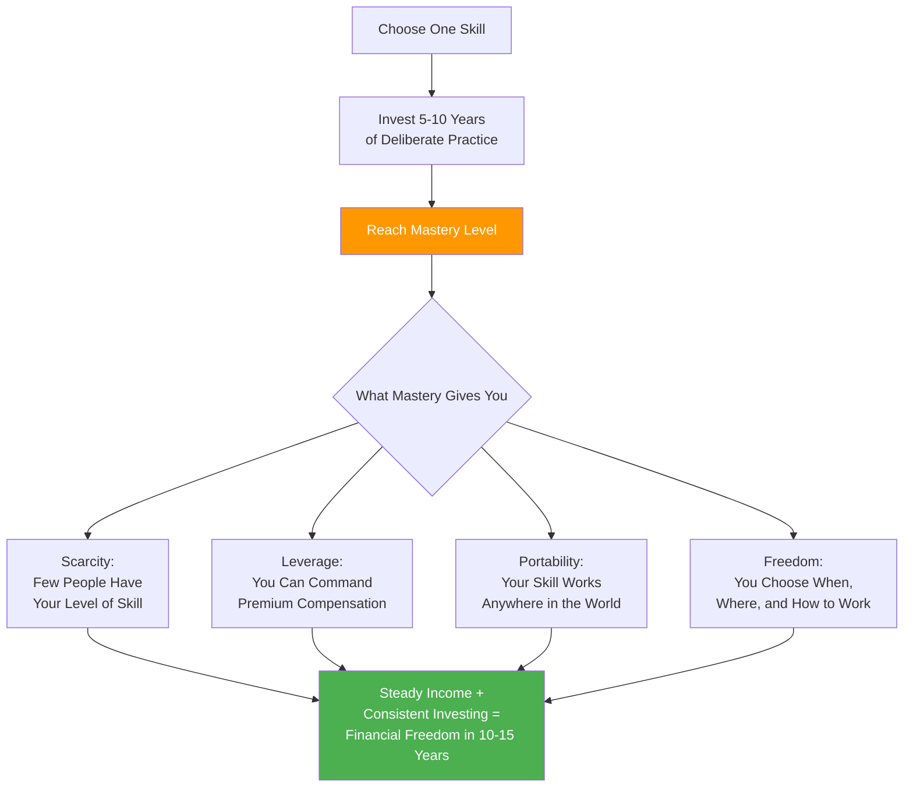
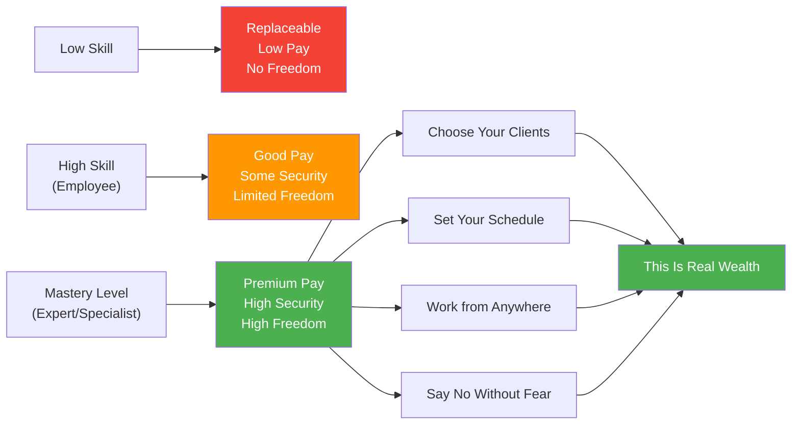
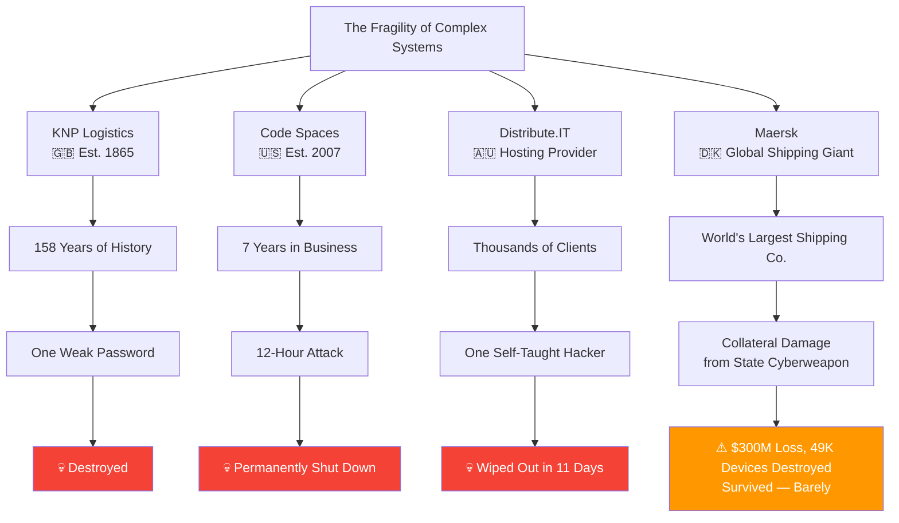
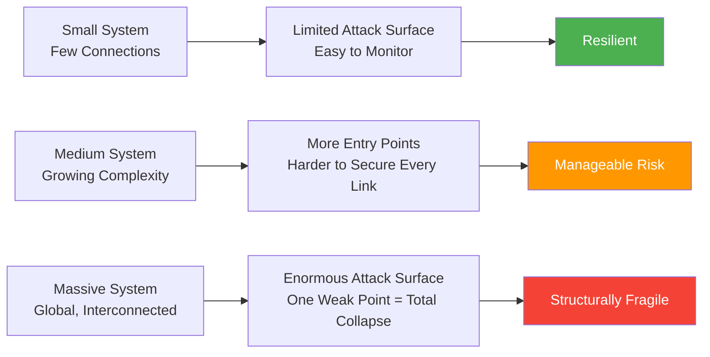
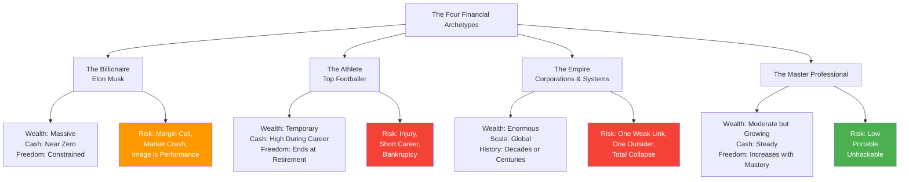

# The Illusion of Liquid Wealth: Why the Ultra-Rich Borrow, Athletes Go Broke, and What "Best Career" Really Means

**Category:** Society & Security  
**Reading time:** ~18 minutes

---

## Introduction

Most people operate under a simple financial assumption: if you are rich, you have a lot of cash in the bank. If you earn a high salary, you are financially safe. And if you want to live a comfortable life, you should find the "easiest" high-paying job.

Reality is far more complex. The financial lives of the ultra-wealthy, professional athletes, and ordinary high-earners follow fundamentally different rules. Understanding these rules is not just fascinating—it is essential for making better decisions about your own career, savings, and security.

This article breaks down three myths:

1. **The Myth of the Rich:** Why billionaires like Elon Musk often have near-zero cash and borrow to live.
2. **The Myth of the Easy Paycheck:** Why top footballers, despite earning millions, frequently go bankrupt—and why their path is anything but "easy."
3. **The Myth of the "Best Job":** Why the safest, most lucrative career is rarely the most glamorous one.

---

## Part 1: The Billionaire's Paradox – Wealth Without Cash

### Zero Salary, Trillion-Dollar Net Worth

In 2025, Tesla's regulatory filings revealed a stunning figure: Elon Musk's reported compensation package was valued at **$158.36 billion**. However, the filing also clarified that his actual cash received for the year was **zero**. Musk takes no salary and no cash bonus from Tesla. His entire net worth—often estimated between **$400 billion and over $1 trillion** depending on market fluctuations—is tied up in stock: primarily Tesla and SpaceX.

This creates a paradox. How does the richest person in the world pay for houses, private jets, security, and daily life if he has no salary?

**Answer:** He borrows against his stock.

### The "Buy, Borrow, Die" Strategy

Musk and many other ultra-high-net-worth individuals utilize a legal financial strategy often summarized as **"Buy, Borrow, Die"**.



**Why not just sell the stock?**

The tax math is brutal. If Musk sold $1 billion worth of Tesla stock, he would face up to **20% federal capital gains tax**, plus a **3.8% net investment income tax**. In high-tax states like California, an additional **13.3%** state tax could apply. In total, nearly **40%** of the proceeds could vanish to taxes, leaving him with just over $600 million out of the initial $1 billion.

By borrowing instead, the loan principal is **not considered income**. It is debt. The IRS cannot tax debt. Musk gets the full $1 billion in cash, pays only **2% to 3% interest** on the loan, and retains ownership of his Tesla shares—which continue to appreciate and pay him dividends (if applicable) or increase his voting power.

### The Mechanics: Collateral, LTV, and Margin Calls

This strategy is not without risk. The loans are **margin loans**—secured by the stock. The bank protects itself using a metric called **Loan-to-Value (LTV)**.

**Formula:**

```
LTV = (Loan Amount ÷ Collateral Value) × 100
```

- A **low LTV** (e.g., 20%) is safe. The stock can fall significantly before the bank worries.
- A **high LTV** (e.g., 50%+) is risky. A moderate drop in stock price triggers a **Margin Call**.



**Tesla's board has imposed strict limits on Musk's personal borrowing:**
His total loans secured by pledged Tesla shares cannot exceed **the lesser of $3.5 billion or 25% of the value of the pledged shares**. Other directors face an even stricter **15% cap**.

Why such tight limits? To prevent a scenario where a sharp drop in Tesla's stock price forces the bank to sell Musk's shares to recover its money—a forced sale that could crash the stock further and jeopardize his control of the company.

### A 10-Year Example: The Borrowing Cycle in Action

Let's trace a realistic 10-year scenario with a hypothetical billionaire (let's call him "Alex") who holds $100 million in a single stock. He pledges it as collateral.

**Assumptions:**
- Initial stock value: **$100 million**
- Bank's LTV limit: **20%** (maximum loan = 20% of collateral value)
- Margin Call trigger: **LTV > 35%**
- Loan interest rate: **3% per year**
- Stock growth: **10% per year** (optimistic but realistic for a strong tech stock)

| Year | Stock Value | Current Loan | LTV | Max Borrowing Capacity (20%) | Action | Cash Available for Spending |
|---|---:|---:|---:|---:|---|---:|
| 0 | $100M | $20M | 20% | $20M | Initial loan | $0 (loan covers spending) |
| 1 | $110M | $20M | 18.2% | $22M | Renew loan | $0 |
| 2 | $121M | $22M | 18.2% | $24.2M | Renew + increase loan | $2M |
| 3 | $133M | $24.2M | 18.2% | $26.6M | Renew + increase loan | $2.4M |
| 4 | $146M | $26.6M | 18.2% | $29.2M | Renew + increase loan | $2.6M |
| 5 | $161M | $29.2M | 18.1% | $32.2M | Renew + increase loan | $3M |
| 6 | $177M | $32.2M | 18.2% | $35.4M | Renew + increase loan | $3.2M |
| 7 | $195M | $35.4M | 18.2% | $39M | Renew + increase loan | $3.6M |
| 8 | $214M | $39M | 18.2% | $42.8M | Renew + increase loan | $3.8M |
| 9 | $236M | $42.8M | 18.1% | $47.2M | Renew + increase loan | $4.4M |
| 10 | $259M | $47.2M | 18.2% | $51.8M | Renew + increase loan | $4.6M |

**What this table shows:**

- **Year 0:** Alex pledges $100M, borrows $20M. He uses this $20M for personal spending. His debt is $20M.
- **Year 1:** Stock grows to $110M. LTV drops to 18.2%. He renews the loan (same $20M) with a new bank. **No new cash.**
- **Year 2:** Stock grows to $121M. He can now borrow up to $24.2M. He takes a new loan of $24.2M, repays the old $20M loan, and has **$4.2M in new cash**—but wait, he also needs to pay 3% interest on the old loan ($600K). Net new cash: **~$3.6M**. He spends it.
- **Years 3-10:** The cycle repeats. Each year, as the stock grows, his borrowing capacity increases. He takes a slightly larger loan, repays the previous one, pays interest, and pockets the difference as spendable cash.

**By Year 10:**
- His stock is worth **$259M**.
- His debt is **$47.2M** (LTV = 18.2%).
- He has extracted and spent approximately **$30M+** in cumulative cash over the decade—**without selling a single share or paying a cent in capital gains tax.**

**But what if the stock doesn't grow?**



**Key insight:** The strategy works **only if the collateral grows**. If the stock stagnates, the billionaire can maintain the debt but cannot extract new cash. If the stock falls sharply, the margin call risk becomes real.

### The Reality Check: How Much Can He Actually Spend?

Forget the trillion-dollar headline. If Musk wanted to liquidate everything and live off cash, the outcome would be far less glamorous.

| Item | Approximate Impact |
|---|---|
| **Gross Asset Value** | ~$900 billion (illustrative) |
| **Market Impact Discount** (selling billions in stock crashes the price) | –5% to –7% |
| **Federal Capital Gains Tax + NIIT** | –~24% |
| **Debt Repayment** (margin loans, etc.) | –Several billion |
| **Realistic Net Cash (if he sold everything)** | **~$500–600 billion** |

Even in this extreme scenario, he would retain hundreds of billions. But the **opportunity cost** is enormous. By selling, he loses future growth, control of his companies, and the ability to use the "Borrow, Borrow, Die" engine.



**The psychological cost:** Living with massive leverage means constant vigilance. Even with a low LTV, the ultra-rich must monitor stock prices, interest rates, and bank relationships. A single market crash or policy change can trigger a chain reaction. The stress is not daily—but it is chronic.

---

## Part 2: The Athlete's Trap – High Cash Flow, Zero Security

If billionaires are "cash-poor," professional athletes are the opposite: they are **cash-rich but security-poor**.

### The Brutal Math of a Football Career

A top-tier footballer might sign a contract worth **$5 million gross per year**. It sounds like a dream. But the net amount is far smaller:

- **Taxes:** In many European countries, the effective tax rate on high incomes can reach **45% to 50%**.
- **Agent Fees:** Typically **5% to 10%** of the gross salary.
- **Other Costs:** Image rights management, insurance, financial advisors, and lifestyle expenses (multiple homes, security, luxury travel) consume another significant portion.

After taxes and fees, a $5 million gross salary might net the player **$2 to $2.5 million**—still a huge sum, but the career is short.

**The typical career length is only 6 to 8 years** for professional footballers. For elite players, it might stretch to 10–15 years. After that, the income tap shuts off—permanently, or at least at that level.

```mermaid
flowchart TD
    A[Footballer Signs $5M/Year Contract] --> B[Gross Salary: $5M]
    B --> C[Taxes: ~45-50% = $2.25-2.5M]
    C --> D[Agent Fees: 5-10% = $250-500K]
    D --> E[Net Income: ~$2-2.25M/Year]
    E --> F[Lifestyle Expenses: Homes, Cars, Family Support, Security]
    F --> G[Savings Potential: $500K-1M/Year]
    G --> H[Career Duration: 6-15 Years]
    H --> I[Total Career Savings: $5-15M]
    I --> J{What Happens After Retirement?}
    J -->|No Planning| K[Financial Difficulties Within 5 Years<br/>~52% of Players (UK PPF Survey)]
    J -->|Good Planning| L[Invest, Start Business,<br/>Live Modestly]
    
    style K fill:#F44336,color:#fff
    style L fill:#4CAF50,color:#fff
```

### The Bankruptcy Epidemic

The statistics are sobering:

- A survey by the **Professional Players Federation (UK)**, covering 800 former professional players in cricket, rugby, and football, found that **52% of respondents reported financial difficulties within five years of retirement**.
- A widely cited **2009 Sports Illustrated report** estimated that **60% of former NBA players go broke within five years** of leaving the league—though this figure has never been confirmed by a peer-reviewed academic study.
- For NFL players, a **2009 Sports Illustrated article** claimed that **78% were bankrupt or under financial stress within two years** of retirement. However, a rigorous **2015 study by the National Bureau of Economic Research (NBER)**, analyzing data on 2,000 players drafted between 1996 and 2003, found the actual bankruptcy filing rate was **15.7% within 12 years** of retirement—dramatically lower, though still striking given these players' earnings.

**Why does this happen?**

The core error is **confusing cash flow with wealth**. A young athlete earning millions per month feels invincible. They buy houses, cars, support extended family, and invest in risky businesses (restaurants, nightclubs, clothing brands) with little financial education. When the career ends—due to injury, age, or loss of form—the income stops, but the **fixed expenses do not**. Divorce can wipe out half of remaining wealth. The result is a financial cliff.

**Ronaldinho's story** is the most famous cautionary tale. The Ballon d'Or winner earned tens of millions during his career at clubs like Barcelona and AC Milan. Yet in 2018, when Brazilian authorities investigated him over a **€2 million fine for illegal construction on protected land** in Porto Alegre, they found only **24.63 Brazilian reais (less than €6)** in his bank accounts. His passport was seized, and he was later arrested in Paraguay for attempting to enter the country with a fake passport—reportedly because he could no longer legally hold a Brazilian one until the fine was paid.

### The Illusion of "Easy Money"

From the outside, a footballer's life looks effortless: play a game you love, earn millions, retire young. The reality is:

- **Extreme physical risk:** One ACL tear or career-ending injury can end everything in a second.
- **Intense public scrutiny:** Every mistake is analyzed by millions.
- **Short earning window:** You must compress a lifetime of savings into roughly a decade.
- **Lack of transferable skills:** Many athletes retire without a degree or professional training, making the transition to normal work difficult.

The cash is real, but the security is an illusion. A footballer who does not actively plan for life after sport is statistically more likely to go broke than a median-income worker.

---

## Part 3: The Point Where Money Becomes Just a Number

So, if being a billionaire is a high-pressure game of leverage and being a footballer is a short-lived cash bonanza, what does a **truly comfortable life** actually require?

### The "Enough" Number: When More Money Stops Mattering

According to the **Charles Schwab 2025 Modern Wealth Survey**, Americans believe the average net worth needed to be "financially comfortable" is **$839,000**—not $839 million, not $8.39 billion. Less than a million dollars. That is the number where people say stress about money largely disappears.

The **FIRE (Financial Independence, Retire Early)** movement puts it even more precisely: take your annual expenses, multiply by 25, and that is roughly how much you need invested to never work again. If you spend $40,000 a year, your number is $1 million. If you spend $60,000, it is $1.5 million. At a safe 4% withdrawal rate, the math sustains itself indefinitely.



Here is the uncomfortable truth: **beyond a certain threshold, more money does not buy more freedom—it buys more complexity.** Musk's $400 billion net worth does not make him 400,000 times freer than someone with $1 million in index funds. In many ways, the person with $1 million and no debt has *more* daily freedom: no margin calls, no board meetings, no stock price anxiety, no public scrutiny of every purchase.

### The Lifestyle Illusion: What You See Online Is Marketing, Not Life

Before we talk about how to reach that "enough" number, we need to address something that keeps many people chasing the wrong target: **the belief that the glamorous lives of the ultra-rich and famous are their actual daily reality.**

They are not. Much of what you see is **deliberate brand-building**.

Consider Elon Musk's gaming persona. In late 2024, Musk appeared on Joe Rogan's podcast and claimed to be one of the top 20 Diablo IV players in the world. His accounts in both Diablo IV and Path of Exile 2 showed characters ranked near the top of global leaderboards. The gaming community was impressed—until he livestreamed himself actually playing.

What viewers saw was a player who struggled with basic mechanics: he could not manage his inventory, ran out of mana repeatedly, did not know how to use potions, and cleared maps inefficiently. Players documented that his account was being accessed from Hong Kong while Musk was in the United States. His Path of Exile 2 account was even spotted logged in and playing *during Trump's inauguration ceremony*, where Musk was physically present on stage.

The gaming community's verdict was unanimous: someone else was leveling his characters. And eventually, Musk confirmed it. In a private message to a fellow gamer that was later made public, he admitted: **"100%. But when I post a video or stream gameplay, it's all me playing."** He acknowledged that "the top accounts in Diablo or PoE require multiple people playing the account to win the leveling race."

The gaming community called it "the biggest gaming fraud in history." But the real lesson is not about video games—it is about **the nature of public image itself**. If the richest person on the planet stages his gaming achievements for social media clout, what else in the curated lives of celebrities and billionaires is performance rather than reality?

The Instagram lifestyle, the casual displays of wealth, the "day in the life" videos—much of it is **content designed to build a personal brand**, not a reflection of daily existence. Understanding this distinction is liberating: you do not need to compete with an image that is not real.

### The One Thing You Actually Need: Mastery

So if $1–2 million in invested assets is genuinely "enough" for financial freedom, and the glamorous lifestyles you see online are largely manufactured, then the question becomes: **how do you get to "enough"?**

The answer is not a specific job title. It is not "become a software engineer" or "go to medical school." It is something more fundamental:

**Take one skill and push it to the level of mastery.**



It does not matter whether the skill is software engineering, surgery, industrial design, data science, or advanced plumbing. What matters is that you reach the level where:

1. **Very few people can do what you do.** Scarcity creates value.
2. **The market consistently pays for it.** Passion without demand is a hobby.
3. **It travels with you.** A skill tied to one employer or one geography is fragile.

A master-level professional in a high-demand field can earn $100,000–$300,000+ per year in many global markets. At that income, reaching $1–2 million in invested assets within 10–15 years is not just possible—it is almost mechanical. Save 20–30% of your income, invest it in diversified index funds, and compound interest does the rest.

### The Balance: Mastery Buys Both Freedom and Security

The ideal career is not "the highest-paying job" or "the easiest job." It is the intersection of **mastery** and **freedom**:



A footballer at age 22 has high cash flow but no freedom—one injury, one bad season, and everything collapses. A billionaire has staggering assets but is chained to stock prices, board politics, and public image management. 

A master-level professional has something neither of them does: **the ability to walk away and rebuild anywhere.** If you lose your job, your skill goes with you. If you move countries, your expertise translates. If the market shifts, your deep knowledge adapts faster than a generalist's surface-level skills.

This is not glamorous. It will not land you on Forbes. But it is the most reliable path to the life that most people actually want: **enough money to not worry, enough freedom to choose how you spend your time, and enough security to sleep at night.**

---

## Part 4: Money Is Not Power—And Power Is Fragile

There is a distinction most people never think about—one that separates those who merely accumulate from those who truly control.

**Money is a tool. Power is the ability to shape outcomes.**

A billionaire with $100 billion in stock has money. But if regulators rewrite the rules, if public opinion turns, if a single vulnerability in the system is exploited—that money can evaporate before the owner even understands what happened. Money sits inside systems. Power is the ability to build, protect, or destroy those systems.

And here is the uncomfortable truth: **the larger and more complex a system becomes, the more fragile it is.**

### Empires That Fell Overnight

History is full of empires—corporate, digital, logistical—that looked invincible from the outside but collapsed in hours because of a single point of failure.

#### KNP Logistics Group: 158 Years, Destroyed by One Password

In 2023, the KNP Logistics Group—a British logistics company that had been in operation for **158 years**—was brought to its knees by a ransomware attack. The attackers exploited a single weak password on an administrator account that lacked multi-factor authentication. The ransomware spread across the company's systems, encrypting critical financial and operational data. The damage was so severe that the company could not recover. KNP Logistics entered administration and was forced to lay off hundreds of workers. **A century and a half of business, ended by one password.**

#### Code Spaces: Seven Years of Work, Gone in 12 Hours

In June 2014, Code Spaces—a code-hosting and project management platform that had been running successfully for seven years—was wiped from existence in a single day. An attacker launched a DDoS attack as a smokescreen, then gained access to the company's Amazon Web Services (AWS) control panel. When Code Spaces tried to regain control by changing passwords, the attacker responded by systematically deleting all data: servers, repositories, backups—everything. Within 12 hours, Code Spaces went from a functioning company to nothing. They posted a final message: *"Code Spaces will not be able to operate beyond this point."* The company had advertised "full redundancy" and a "proven recovery plan." None of it mattered.

#### Distribute.IT: Erased by a Self-Taught Hacker in 11 Days

In 2011, Distribute.IT, an Australian web hosting provider serving thousands of clients, was attacked by a lone individual—a self-taught hacker with no formal training. Over the course of 11 days, the attacker methodically gained access, deleted servers, wiped backups, and destroyed client websites. Thousands of businesses lost their websites, emails, and data permanently. Distribute.IT shut down. One person with a laptop undid an entire company and the digital presence of thousands of businesses that relied on it.

#### Maersk: The World's Shipping Giant, Crippled in Seven Minutes

In June 2017, A.P. Møller-Maersk—the world's largest container shipping company, responsible for nearly one-fifth of global shipping capacity—was hit by the NotPetya malware. The attack was not even aimed at Maersk; it was collateral damage from a state-sponsored cyberweapon targeting Ukraine. Within **seven minutes**, the malware had spread across 65 countries, destroying 49,000 laptops, 4,000 servers, and disabling 17 of the company's 76 shipping terminals. Maersk was forced to conduct operations manually—using paper, WhatsApp, and personal email accounts—while it rebuilt its entire IT infrastructure from scratch in 10 days. The cost: **$250–$300 million**. And Maersk was lucky—it survived. NotPetya caused an estimated **$10 billion in total global damage**, making it the most destructive cyberattack in history at the time.



### The Paradox: Scale Creates Vulnerability

Notice the pattern. These were not small, careless startups. KNP Logistics survived two world wars. Maersk moves 12 million containers a year. Code Spaces had "full redundancy" and practiced recovery plans. They were large, established, and resource-rich.

**And that is exactly what made them vulnerable.**

Every server added to a network is a new door that can be opened. Every employee with a password is a potential entry point. Every layer of complexity is another place where a single crack can bring down the whole structure. The bigger the system, the more attack surface it has. The more interconnected its parts, the faster a failure cascades.



This is why money alone is not power. You can have billions in assets, but if those assets exist inside a system you do not fully control—a stock exchange, a cloud server, a supply chain, a banking network—then your wealth is exactly as secure as the **weakest link** in that system. And in a world of interconnected digital infrastructure, the weakest link is often a single password, a single unpatched server, or a single employee who clicks the wrong email.

**Power is not what you accumulate. It is what you can protect—and what you can rebuild when the system breaks.**

This brings us back to mastery. The footballer's money disappears because it was stored in a system (lifestyle, advisors, contracts) that collapsed. The billionaire's wealth trembles when markets shift because it lives inside a system (stock valuations, public confidence) that can be shaken by a tweet. The companies above collapsed because their entire existence depended on systems that could be breached by one outsider.

But a skill—a mastered craft—does not live inside a system. It lives inside you. No hacker can delete your expertise. No ransomware can encrypt your knowledge. No margin call can wipe out your ability to think, create, and solve problems.

---

## Conclusion: The Real Currency Is Not Cash—It Is Mastery

The stories of Elon Musk, bankrupt footballers, and obliterated corporations seem worlds apart. One has too much leverage; another, too little foresight; and others, too much blind trust in systems they did not truly control. But they share a common thread: **the illusion that size, wealth, or history makes you invincible.**

Musk's wealth is illiquid, his freedom constrained by stock prices and public scrutiny—and even his gaming achievements turn out to be staged. The footballer's wealth is temporary, compressed into a decade that ends with a cliff. A 158-year-old company can be destroyed by a single password. And the glamorous lifestyles broadcast on social media are, more often than not, **brand-building performances rather than daily reality.**



The truly secure path is not about earning the most, appearing the richest, or building the largest empire. It is about **mastering one thing so deeply that the market always needs you, and investing steadily until work becomes a choice rather than a necessity.**

You do not need a trillion dollars. You do not need a €5 million contract. You do not need an empire with 45,000 computers. You need **one skill, pushed to mastery, and the discipline to let compound interest do its work.**

That is the real wealth. And unlike a stock price, a football career, or a server behind a weak password—**no one can take it from you.**

---

2026/11/17
