# 流動的富の幻想：超富裕層が借金する理由、アスリートが破産する理由、そして「最高のキャリア」の本当の意味

**カテゴリー:** 社会とセキュリティ  
**読了時間:** 約20分

---

## はじめに

多くの人は単純な金融の前提で生きています。お金持ちなら銀行に大量の現金がある。高い給料をもらっていれば経済的に安全だ。快適な生活を送りたければ、「一番楽な」高収入の仕事を見つければいい、と。

現実ははるかに複雑です。超富裕層、プロアスリート、そして一般的な高収入者の経済生活は、根本的に異なるルールに従っています。これらのルールを理解することは、単に興味深いだけでなく、自分自身のキャリア、貯蓄、そしてセキュリティについてより良い判断を下すために不可欠です。

この記事では3つの神話を解体します：

1. **富裕層の神話：** イーロン・マスクのような億万長者がなぜ現金がほぼゼロで、借金で生活しているのか。
2. **楽な報酬の神話：** トップサッカー選手がなぜ何百万ドルも稼ぎながら頻繁に破産するのか、そしてその道がなぜ「楽」とは程遠いのか。
3. **「最高の仕事」の神話：** 最も安全で最も収益性の高いキャリアが、なぜ最も華やかなものではないのか。

---

## パート1：億万長者のパラドックス — 現金なき富

### ゼロの給料、数兆ドルの純資産

2025年、Teslaの規制当局への提出書類で驚くべき数字が明らかになりました。イーロン・マスクの報酬パッケージは**1,583.6億ドル**と評価されていましたが、その年の実際に受け取った現金は**ゼロ**でした。マスクはTeslaから給料も現金ボーナスも受け取っていません。彼の純資産全体（市場の変動によって**4,000億ドルから1兆ドル以上**と推定されることが多い）は株式、主にTeslaとSpaceXの株に縛られています。

これがパラドックスを生み出します。世界一の富豪が、給料なしでどうやって家や自家用ジェット、警備費、日常生活費を払っているのでしょうか？

**答え：** 株を担保にして借金をしているのです。

### 「Buy, Borrow, Die（買って、借りて、死ぬ）」戦略

マスクや多くの超富裕層は、**「Buy, Borrow, Die」**としてよく要約される合法的な金融戦略を活用しています。

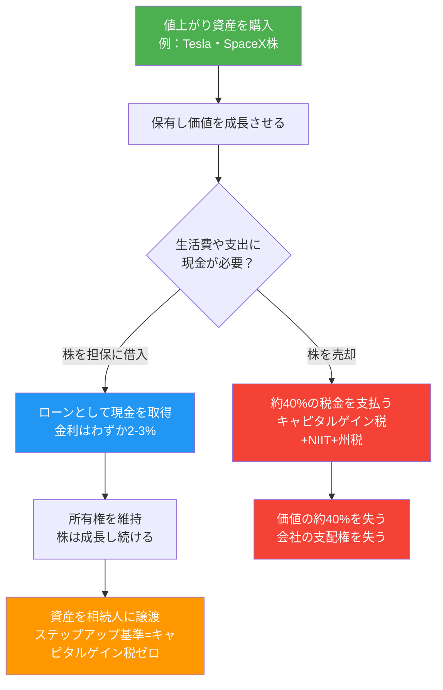

**なぜ単純に株を売らないのか？**

税金の計算は過酷です。マスクがTesla株を10億ドル分売却した場合、**連邦キャピタルゲイン税20%**に加え、**純投資所得税3.8%**が課されます。カリフォルニアのような高税率の州では、さらに**13.3%**の州税が加わる可能性があります。合計すると、収益の約**40%**が税金に消え、当初の10億ドルからわずか6億ドル強しか手元に残りません。

代わりに借入をすれば、ローンの元金は**所得とみなされません**。それは負債です。IRSは負債に課税できません。マスクは10億ドル全額を現金で手に入れ、ローンに対して**年利2〜3%**の利息を支払うだけで、Tesla株の所有権を維持できます。株は引き続き値上がりし、議決権も保持できるのです。

### メカニズム：担保、LTV、マージンコール

この戦略にはリスクがないわけではありません。ローンは**マージンローン**、つまり株式を担保とするローンです。銀行は**LTV（Loan-to-Value、融資対担保比率）**という指標を使って自らを守ります。

**計算式：**

```
LTV = (ローン金額 ÷ 担保価値) × 100
```

- **低いLTV**（例：20%）は安全です。株価がかなり下落しても銀行は心配しません。
- **高いLTV**（例：50%以上）はリスクが高いです。株価の適度な下落で**マージンコール**が発生します。

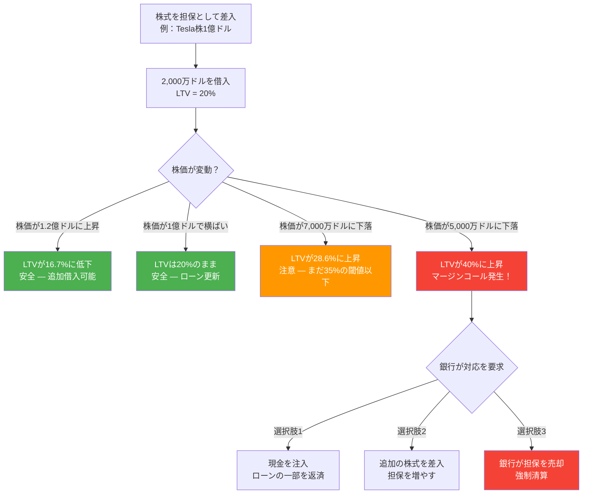

**Teslaの取締役会はマスクの個人借入に厳格な制限を課しています：**
担保として差し入れたTesla株に対する総借入額は、**35億ドルまたは差し入れた株式価値の25%のいずれか少ない方**を超えてはなりません。他の取締役にはさらに厳しい**15%の上限**が適用されます。

なぜこれほど厳しい制限があるのでしょうか？Tesla株価の急落によって銀行がマスクの株式を売却せざるを得なくなるシナリオを防ぐためです。強制売却はさらなる株価暴落を引き起こし、会社の支配権を脅かす可能性があります。

### 10年間の例：借入サイクルの実際

仮想の億万長者（「アレックス」としましょう）が1億ドルの単一株式を保有し、それを担保として差し入れた場合の、現実的な10年間のシナリオを追ってみましょう。

**前提条件：**
- 初期株式価値：**1億ドル**
- 銀行のLTV上限：**20%**（最大借入額 = 担保価値の20%）
- マージンコール発動条件：**LTV > 35%**
- ローン金利：**年3%**
- 株式成長率：**年10%**（楽観的だが強力なテック株として現実的）

| 年 | 株式価値 | 現在のローン | LTV | 最大借入能力 (20%) | アクション | 支出可能な現金 |
|---|---:|---:|---:|---:|---|---:|
| 0 | 1億ドル | 2,000万ドル | 20% | 2,000万ドル | 初回ローン | 0ドル（ローンは支出に充当） |
| 1 | 1.1億ドル | 2,000万ドル | 18.2% | 2,200万ドル | ローン更新 | 0ドル |
| 2 | 1.21億ドル | 2,200万ドル | 18.2% | 2,420万ドル | 更新+増額 | 200万ドル |
| 3 | 1.33億ドル | 2,420万ドル | 18.2% | 2,660万ドル | 更新+増額 | 240万ドル |
| 4 | 1.46億ドル | 2,660万ドル | 18.2% | 2,920万ドル | 更新+増額 | 260万ドル |
| 5 | 1.61億ドル | 2,920万ドル | 18.1% | 3,220万ドル | 更新+増額 | 300万ドル |
| 6 | 1.77億ドル | 3,220万ドル | 18.2% | 3,540万ドル | 更新+増額 | 320万ドル |
| 7 | 1.95億ドル | 3,540万ドル | 18.2% | 3,900万ドル | 更新+増額 | 360万ドル |
| 8 | 2.14億ドル | 3,900万ドル | 18.2% | 4,280万ドル | 更新+増額 | 380万ドル |
| 9 | 2.36億ドル | 4,280万ドル | 18.1% | 4,720万ドル | 更新+増額 | 440万ドル |
| 10 | 2.59億ドル | 4,720万ドル | 18.2% | 5,180万ドル | 更新+増額 | 460万ドル |

**この表が示していること：**

- **0年目：** アレックスは1億ドルを担保に差し入れ、2,000万ドルを借り入れます。この2,000万ドルを個人的な支出に使います。負債は2,000万ドルです。
- **1年目：** 株式が1.1億ドルに成長。LTVは18.2%に低下。新しい銀行で同じ2,000万ドルのローンを更新。**新たな現金なし。**
- **2年目：** 株式が1.21億ドルに成長。最大2,420万ドルまで借入可能に。2,420万ドルの新しいローンを組み、旧ローンの2,000万ドルを返済し、**420万ドルの新たな現金**を手にしますが、旧ローンの年利3%（60万ドル）も支払う必要があります。実質的な新規現金：**約360万ドル**。これを使います。
- **3〜10年目：** サイクルが繰り返されます。毎年、株式が成長するにつれて借入能力が増加。やや大きなローンを組み、前のローンを返済し、利息を支払い、差額を使える現金として受け取ります。

**10年目までに：**
- 株式は**2.59億ドル**の価値。
- 負債は**4,720万ドル**（LTV = 18.2%）。
- 10年間で累計約**3,000万ドル以上**の現金を引き出して使用しました。**株式を1株も売却せず、キャピタルゲイン税を1セントも支払うことなく。**

**しかし、株式が成長しなかったら？**

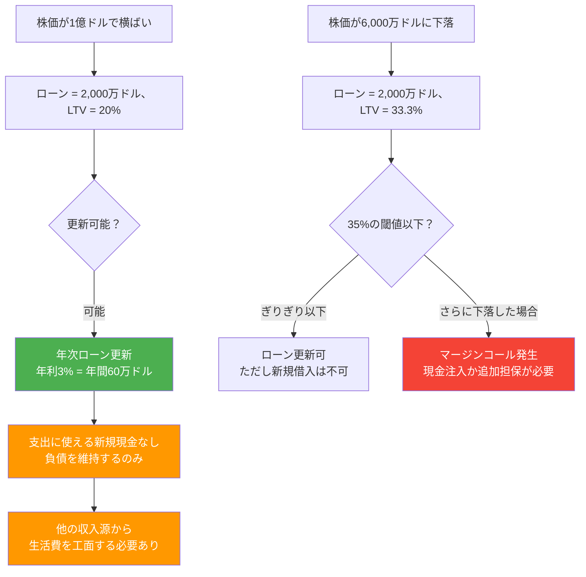

**重要な洞察：** この戦略は**担保が成長する場合にのみ機能します**。株価が停滞すれば、億万長者は負債を維持できますが新たな現金は引き出せません。株価が急落すれば、マージンコールのリスクが現実のものとなります。

### 現実チェック：実際にいくら使えるのか？

数兆ドルの見出しは忘れましょう。もしマスクがすべてを清算して現金で生活しようとしたら、結果はずっと地味なものになります。

| 項目 | おおよその影響 |
|---|---|
| **総資産価値** | 約9,000億ドル（例示） |
| **市場影響ディスカウント**（数十億ドルの株売却は株価を暴落させる） | −5%〜−7% |
| **連邦キャピタルゲイン税 + NIIT** | −約24% |
| **債務返済**（マージンローン等） | −数十億ドル |
| **現実的な手取り現金（すべて売却した場合）** | **約5,000〜6,000億ドル** |

この極端なシナリオでも、数千億ドルは残ります。しかし**機会費用**は莫大です。売却することで、将来の成長、会社の支配権、そして「Borrow, Borrow, Die」エンジンを使う能力を失います。

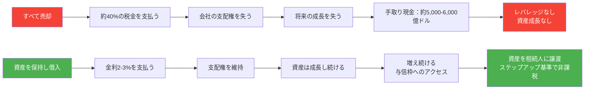

**心理的コスト：** 大きなレバレッジを抱えて生きることは、常に警戒を要します。たとえLTVが低くても、超富裕層は株価、金利、銀行との関係を監視し続けなければなりません。日常的なストレスではありませんが、慢性的なストレスです。

---

## パート2：アスリートの罠 — 高いキャッシュフロー、ゼロのセキュリティ

億万長者が「現金不足」であるなら、プロアスリートはその逆です。彼らは**現金は豊富だがセキュリティがない**のです。

### サッカー選手キャリアの残酷な計算

トップクラスのサッカー選手が**年間500万ドルの総額**の契約を結ぶかもしれません。夢のような話に聞こえます。しかし手取り額ははるかに少なくなります：

- **税金：** 多くのヨーロッパ諸国では、高所得者の実効税率は**45%〜50%**に達する可能性があります。
- **エージェント料：** 通常、総額の**5%〜10%**。
- **その他のコスト：** 肖像権管理、保険、ファイナンシャルアドバイザー、そしてライフスタイル関連の出費（複数の住居、警備、豪華な旅行）がさらにかなりの部分を消費します。

税金と手数料を差し引くと、500万ドルの総額給与から選手の手元に残るのは**200万〜250万ドル**程度です。それでも大きな金額ですが、キャリアは短いのです。

**プロサッカー選手の典型的なキャリア期間はわずか6〜8年です。** エリート選手の場合、10〜15年に延びることもあります。その後、収入の蛇口は閉まります。永久に、あるいは少なくともそのレベルでは。

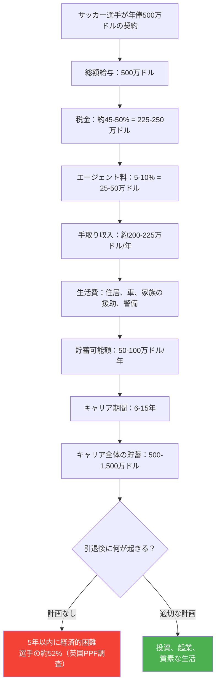

### 破産の流行

統計は厳しい現実を示しています：

- **Professional Players Federation（英国）**の調査では、クリケット、ラグビー、サッカーの元プロ選手800人を対象に、**回答者の52%が引退後5年以内に経済的困難を報告しました**。
- 広く引用される**2009年のSports Illustrated誌のレポート**では、**元NBA選手の60%がリーグを離れてから5年以内に破産する**と推定されましたが、この数字は査読付き学術研究では確認されていません。
- NFL選手については、**2009年のSports Illustrated誌の記事**で**引退後2年以内に78%が破産または経済的ストレスにある**と主張されました。しかし、**全米経済研究所（NBER）の2015年の厳密な研究**で、1996年から2003年にドラフトされた2,000人の選手のデータを分析した結果、実際の破産申請率は**引退後12年以内で15.7%**でした。大幅に低い数字ですが、これらの選手の収入を考えるとなお衝撃的です。

**なぜこのようなことが起きるのか？**

根本的な間違いは、**キャッシュフローと富を混同すること**です。毎月何百万ドルも稼ぐ若いアスリートは無敵だと感じます。家、車を買い、大家族を支援し、ほとんど金融教育を受けないままリスクの高いビジネス（レストラン、ナイトクラブ、アパレルブランド）に投資します。キャリアが終わるとき（怪我、加齢、フォームの喪失により）、収入は止まりますが、**固定費は止まりません**。離婚で残りの資産の半分が消えることもあります。結果は経済的な崖です。

**ロナウジーニョの物語**は最も有名な教訓です。バロンドール受賞者は、バルセロナやACミランなどのクラブで何千万ドルも稼ぎました。しかし2018年、ブラジル当局がポルトアレグレの**保護地域での違法建築に対する200万ユーロの罰金**について調査したとき、彼の銀行口座にはわずか**24.63ブラジルレアル（6ユーロ未満）**しかありませんでした。パスポートは押収され、後にパラグアイに偽造パスポートで入国しようとして逮捕されました。報道によると、罰金が支払われるまでブラジルのパスポートを合法的に保持できなくなったためです。

### 「楽な金」の幻想

外から見ると、サッカー選手の生活は楽に見えます。好きなゲームをして、何百万も稼ぎ、若くして引退する。現実は：

- **極度の身体的リスク：** 一度のACL断裂やキャリアを終わらせる怪我で、すべてが一瞬で終わる可能性があります。
- **強烈な世間の監視：** あらゆるミスが何百万もの人に分析されます。
- **短い収入期間：** 一生分の貯蓄を約10年に凝縮しなければなりません。
- **転用可能なスキルの欠如：** 多くのアスリートは学位や専門的な訓練なしに引退し、通常の仕事への移行が困難になります。

現金は本物ですが、セキュリティは幻想です。スポーツ後の人生を積極的に計画しないサッカー選手は、統計的に中央値の収入の労働者よりも破産する可能性が高いのです。

---

## パート3：お金がただの数字になるポイント

億万長者であることがレバレッジの高圧ゲームであり、サッカー選手であることが短命の現金ボナンザであるなら、**本当に快適な生活**には実際に何が必要なのでしょうか？

### 「十分」な金額：お金がこれ以上重要でなくなるとき

**Charles Schwabの2025年Modern Wealth Survey**によると、アメリカ人が「経済的に快適」であるために必要だと考える平均純資産は**839,000ドル**です。8億3,900万ドルでも、83億9,000万ドルでもなく、100万ドル未満です。これがお金に関するストレスがほぼ消えるとされる数字です。

**FIRE（Financial Independence, Retire Early = 経済的自立、早期退職）**ムーブメントはさらに正確に定義します。年間支出に25を掛けた金額が、二度と働かなくて済むおおよその投資額です。年間4万ドル使うなら、目標額は100万ドル。年間6万ドルなら、150万ドル。安全な4%の取り崩し率で、この計算は無期限に持続します。

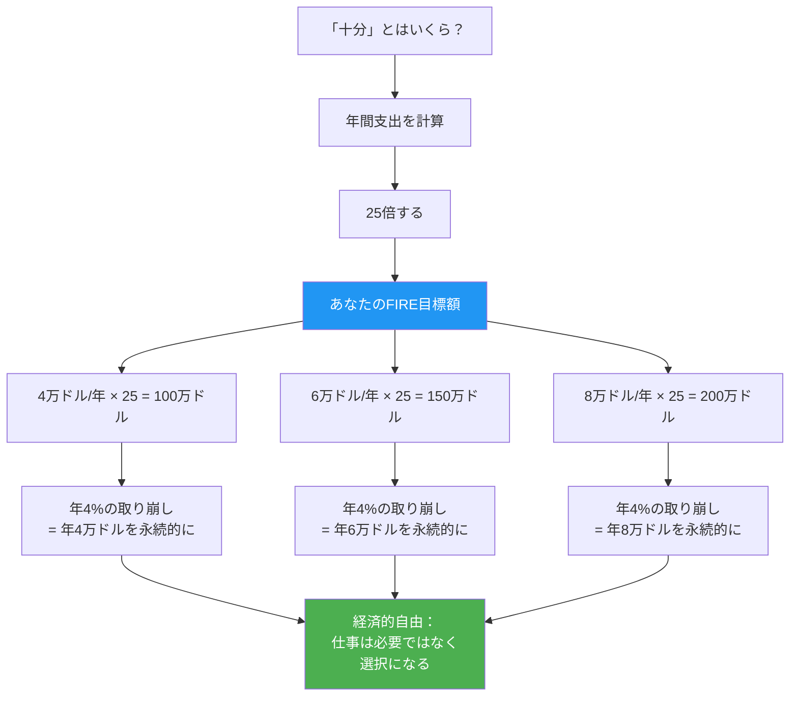

ここに不快な真実があります：**ある一定の閾値を超えると、より多くのお金はより多くの自由を買わず、より多くの複雑さを買います。** マスクの4,000億ドルの純資産は、インデックスファンドに100万ドルを持つ人の40万倍自由であることを意味しません。多くの点で、100万ドルと無借金の人の方が*日常的な自由度は高い*のです。マージンコールなし、取締役会なし、株価の不安なし、あらゆる買い物への世間の監視なし。

### ライフスタイルの幻想：オンラインで見るものはマーケティングであり、人生ではない

「十分」な金額に到達する方法を語る前に、多くの人を間違った目標に向かわせ続けているものに触れる必要があります：**超富裕層や有名人の華やかな生活が、彼らの実際の日常であるという信念です。**

そうではありません。あなたが見ているものの多くは**意図的なブランド構築**です。

イーロン・マスクのゲーミングペルソナを考えてみましょう。2024年後半、マスクはJoe Roganのポッドキャストに出演し、Diablo IVの世界トップ20プレイヤーの一人だと主張しました。Diablo IVとPath of Exile 2の両方で彼のアカウントはグローバルリーダーボードの上位近くにランクされていました。ゲーミングコミュニティは感心していましたが、彼が実際にプレイするところをライブ配信するまでは。

視聴者が見たのは、基本的な操作に苦戦するプレイヤーでした。インベントリを管理できず、マナが繰り返し切れ、ポーションの使い方を知らず、マップを非効率にクリアしていました。プレイヤーたちは、マスクがアメリカにいる間に彼のアカウントが香港からアクセスされていることを記録しました。彼のPath of Exile 2のアカウントは、マスクが物理的にステージ上にいた*トランプの就任式の最中に*ログインしてプレイしているのが確認されました。

ゲーミングコミュニティの判定は一致していました。誰か別の人がキャラクターをレベリングしていたのです。そして最終的にマスクはそれを認めました。後に公開されたあるゲーマーへのプライベートメッセージで、彼はこう認めました：**「100%そうだ。でも動画を投稿したりゲームプレイを配信するときは、全部自分でプレイしている。」** 彼は「DiabloやPoEのトップアカウントはレベリングレースに勝つために複数の人がアカウントをプレイする必要がある」と認めました。

ゲーミングコミュニティはこれを「ゲーム史上最大の詐欺」と呼びました。しかし本当の教訓はビデオゲームのことではありません。**パブリックイメージの本質**についてです。地球上で最も裕福な人がソーシャルメディアでの注目のためにゲームの実績を偽るなら、セレブや億万長者のキュレーションされた生活の他に何がパフォーマンスなのでしょうか？

Instagramのライフスタイル、さりげない富の誇示、「一日の生活」動画の多くは、**パーソナルブランドを構築するために設計されたコンテンツ**であり、日常の反映ではありません。この区別を理解することは解放的です。現実ではないイメージと競争する必要はないのです。

### 本当に必要なたった一つのこと：マスタリー（熟達）

投資資産100〜200万ドルが経済的自由のために本当に「十分」であり、オンラインで見る華やかなライフスタイルが大部分は作り物であるなら、問題は次のようになります：**どうやって「十分」に到達するのか？**

答えは特定の職業名ではありません。「ソフトウェアエンジニアになれ」でも「医学部に行け」でもありません。もっと根本的なことです：

**一つのスキルを取り、マスタリー（熟達）のレベルまで押し上げること。**

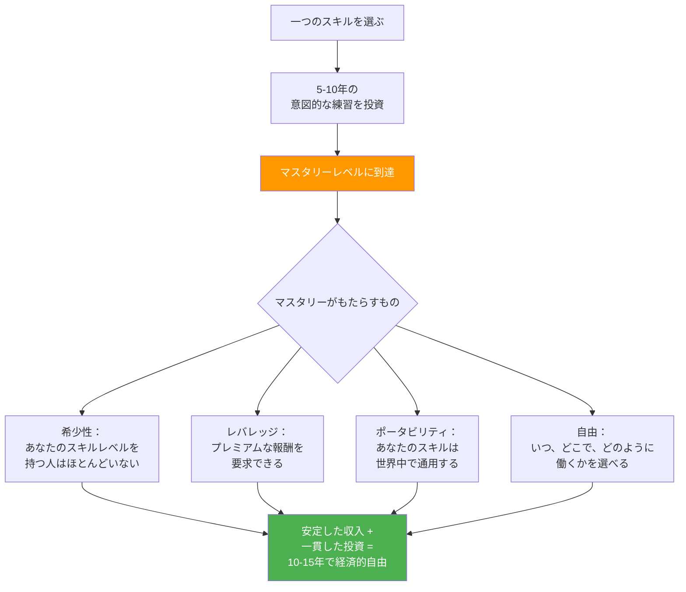

スキルがソフトウェアエンジニアリングであろうと、外科手術であろうと、工業デザイン、データサイエンス、高度な配管工事であろうと関係ありません。重要なのは、次のレベルに到達することです：

1. **あなたにできることをできる人がほとんどいない。** 希少性が価値を生みます。
2. **市場が一貫してそれに対価を支払う。** 需要のない情熱は趣味です。
3. **それがあなたとともに移動する。** 一つの雇用主や一つの地域に縛られたスキルは脆弱です。

高需要分野のマスターレベルの専門家は、多くのグローバル市場で年間10万〜30万ドル以上を稼ぐことができます。その収入なら、10〜15年以内に投資資産100〜200万ドルに到達することは可能であるだけでなく、ほぼ機械的です。収入の20〜30%を貯蓄し、分散インデックスファンドに投資すれば、複利が残りの仕事をしてくれます。

### バランス：マスタリーは自由とセキュリティの両方を買う

理想的なキャリアは「最も高収入の仕事」でも「最も楽な仕事」でもありません。**マスタリー**と**自由**の交差点です：

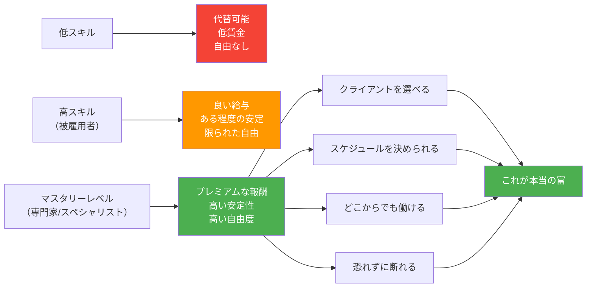

22歳のサッカー選手はキャッシュフローは高いが自由はありません。一度の怪我、一度の不調なシーズンですべてが崩壊します。億万長者は驚異的な資産を持っていますが、株価、取締役会の政治、そしてパブリックイメージの管理に縛られています。

マスターレベルの専門家は、どちらも持っていないものを持っています：**立ち去ってどこでもやり直す能力です。** 仕事を失っても、スキルはあなたとともにあります。国を移っても、あなたの専門知識は翻訳されます。市場が変化しても、深い知識はジェネラリストの表面的なスキルより速く適応します。

これは華やかではありません。Forbesに載ることもないでしょう。しかし、ほとんどの人が実際に望んでいる生活への最も確実な道です：**心配しなくて済むだけのお金、時間の使い方を選べるだけの自由、そして夜安心して眠れるだけのセキュリティ。**

---

## パート4：お金は権力ではない — そして権力は脆い

ほとんどの人が考えもしない区別があります。それは、単に蓄積する人と真に支配する人を分けるものです。

**お金はツールです。権力は結果を左右する能力です。**

株式で1,000億ドルを持つ億万長者にはお金があります。しかし、規制当局がルールを書き換えたら、世論が反転したら、システムの一つの脆弱性が悪用されたら、そのお金は所有者が何が起きたか理解する前に蒸発する可能性があります。お金はシステムの中に存在します。権力とは、それらのシステムを構築し、保護し、または破壊する能力です。

そして不快な真実があります：**システムが大きく複雑になるほど、それはより脆くなります。**

### 一夜にして崩壊した帝国

歴史は、外からは無敵に見えたが、単一の障害点のために数時間で崩壊した帝国（企業、デジタル、物流）に満ちています。

#### KNP Logistics Group：158年の歴史、一つのパスワードで破壊

2023年、KNP Logistics Group（**158年間**営業していたイギリスの物流会社）はランサムウェア攻撃によって壊滅しました。攻撃者は多要素認証のない管理者アカウントの一つの弱いパスワードを悪用しました。ランサムウェアは会社のシステム全体に広がり、重要な財務・運用データを暗号化しました。損害は深刻で、会社は回復できませんでした。KNP Logisticsは管理手続きに入り、数百人の労働者を解雇せざるを得ませんでした。**1世紀半のビジネスが、一つのパスワードで終わりました。**

#### Code Spaces：7年間の成果、12時間で消滅

2014年6月、Code Spaces（7年間成功裏に運営されていたコードホスティングおよびプロジェクト管理プラットフォーム）は一日で消滅しました。攻撃者は煙幕としてDDoS攻撃を仕掛け、その後会社のAmazon Web Services（AWS）コントロールパネルへのアクセスを取得しました。Code Spacesがパスワードの変更でコントロールを取り戻そうとすると、攻撃者はすべてのデータを体系的に削除して対抗しました。サーバー、リポジトリ、バックアップ、すべてです。12時間以内に、Code Spacesは機能する企業から無に変わりました。最後のメッセージを投稿しました：*「Code Spacesはこの時点を超えて運営を続けることができません。」* 同社は「完全な冗長性」と「実証済みの復旧計画」を宣伝していました。どれも役に立ちませんでした。

#### Distribute.IT：独学のハッカーに11日で消去

2011年、Distribute.IT（数千のクライアントにサービスを提供するオーストラリアのウェブホスティングプロバイダー）は一人の個人、正式な訓練を受けていない独学のハッカーに攻撃されました。11日間にわたり、攻撃者は計画的にアクセスを取得し、サーバーを削除し、バックアップを消去し、クライアントのウェブサイトを破壊しました。数千のビジネスがウェブサイト、メール、データを永久に失いました。Distribute.ITは閉鎖されました。ラップトップ一台を持った一人の人間が、一つの企業とそれに依存していた数千のビジネスのデジタルプレゼンスを壊滅させたのです。

#### Maersk：世界の海運大手、7分で機能停止

2017年6月、A.P. Møller-Maersk（世界のコンテナ海運能力の約5分の1を担う世界最大のコンテナ海運会社）がNotPetyaマルウェアに襲われました。攻撃はMaerskを標的としたものではありませんでした。ウクライナを標的とした国家支援のサイバー兵器の巻き添え被害だったのです。**7分以内に**、マルウェアは65カ国に広がり、49,000台のラップトップ、4,000台のサーバーを破壊し、同社の76の海運ターミナルのうち17を無効化しました。Maerskは10日間でIT基盤全体をゼロから再構築する間、紙、WhatsApp、個人のメールアカウントを使って手動で業務を行うことを余儀なくされました。コスト：**2億5,000万〜3億ドル**。そしてMaerskは幸運でした。生き残ったのです。NotPetyaは推定**100億ドルの世界的な損害**を引き起こし、当時史上最も破壊的なサイバー攻撃となりました。

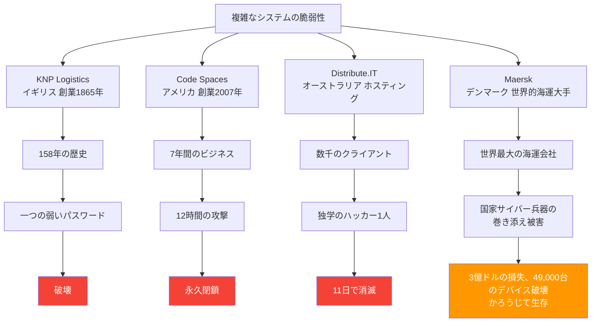

### パラドックス：規模が脆弱性を生む

パターンに注目してください。これらは小さく不注意なスタートアップではありませんでした。KNP Logisticsは2つの世界大戦を生き延びました。Maerskは年間1,200万個のコンテナを運びます。Code Spacesは「完全な冗長性」と実践された復旧計画を持っていました。大規模で、確立され、資源豊富でした。

**そしてそれがまさに彼らを脆弱にしたのです。**

ネットワークに追加されるすべてのサーバーは、開かれる可能性のある新しいドアです。パスワードを持つすべての従業員は潜在的な侵入点です。すべての複雑さの層は、単一の亀裂が全体の構造を崩壊させる新たな場所です。システムが大きければ大きいほど、攻撃対象面は広くなります。各部分の相互接続が密であるほど、障害の連鎖は速くなります。

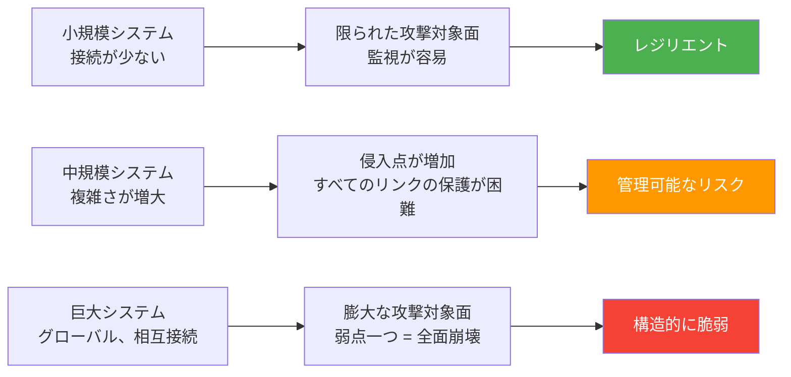

これが、お金だけでは権力ではない理由です。資産に何十億ドルあっても、それらの資産が完全にはコントロールできないシステム（証券取引所、クラウドサーバー、サプライチェーン、銀行ネットワーク）の中に存在するなら、あなたの富はそのシステムの**最も弱いリンク**と同じだけ安全なのです。そして相互接続されたデジタルインフラの世界では、最も弱いリンクはしばしば一つのパスワード、一つのパッチ未適用のサーバー、または間違ったメールをクリックした一人の従業員です。

**権力とは蓄積するものではありません。保護できるもの、そしてシステムが壊れたときに再構築できるものです。**

これはマスタリーに話を戻します。サッカー選手のお金が消えるのは、崩壊したシステム（ライフスタイル、アドバイザー、契約）に蓄えられていたからです。億万長者の富が揺れるのは、一つのツイートで揺さぶられるシステム（株式評価額、市場の信頼）の中に存在するからです。上記の企業が崩壊したのは、一人の外部者に侵入されうるシステムに存在全体が依存していたからです。

しかしスキル、熟達した技術は、システムの中に存在しません。あなたの中に存在します。ハッカーはあなたの専門知識を削除できません。ランサムウェアはあなたの知識を暗号化できません。マージンコールはあなたの思考し、創造し、問題を解決する能力を消し去ることはできません。

---

## 結論：本当の通貨は現金ではなくマスタリーである

イーロン・マスク、破産したサッカー選手、そして壊滅した企業の物語は、まったく別の世界のように見えます。一方はレバレッジが大きすぎ、もう一方は先見の明がなさすぎ、その他はコントロールしていないシステムへの盲信が大きすぎました。しかし共通の糸でつながっています：**規模、富、または歴史が無敵にするという幻想です。**

マスクの富は流動性がなく、彼の自由は株価と世間の監視に制約されています。ゲームの実績さえ演出されていたことが判明しました。サッカー選手の富は一時的で、崖で終わる10年間に圧縮されています。158年の歴史を持つ企業が一つのパスワードで破壊されることもあります。そしてソーシャルメディアで発信される華やかなライフスタイルは、多くの場合、**日常の現実ではなくブランド構築のパフォーマンス**です。

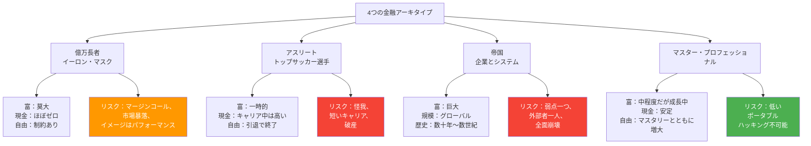

真に安全な道は、最も多く稼ぐこと、最も裕福に見えること、最大の帝国を築くことではありません。**一つのことを深く熟達し、市場が常にあなたを必要とするようになり、仕事が必要ではなく選択になるまで着実に投資すること**です。

1兆ドルは必要ありません。500万ユーロの契約は必要ありません。45,000台のコンピューターを持つ帝国は必要ありません。必要なのは**一つのスキル、マスタリーまで押し上げること、そして複利に仕事をさせる規律**です。

それが本当の富です。そして株価、サッカーのキャリア、弱いパスワードの背後にあるサーバーとは違い、**誰もそれをあなたから奪うことはできません。**

---

*この記事は教育目的のみであり、金融やキャリアに関するアドバイスを構成するものではありません。個人の状況は異なります。*

**最終更新日:** 2026年11月  
**著者:** Sudoxs  
**カテゴリー:** 社会とセキュリティ  
**URL:** https://sudoxs.github.io/sudoxsweb/
